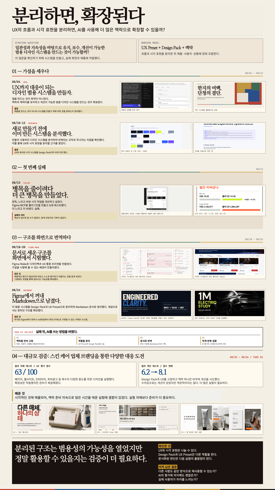

# C5 UES Lab

## C5 연대기 · 최종 포스터

[](presentations/c5-chronicle-poster-draft/poster-final.png)

[원본 크기 이미지 (2880 × 5120)](presentations/c5-chronicle-poster-draft/poster-final.png) · [포스터 HTML 소스](presentations/c5-chronicle-poster-draft/v6-Korean-Commercial.html)

[웹 연대기 HTML 소스](presentations/c5-chronicle/index.html)

> **Evidence-driven Experience System Laboratory**

이 작업공간은 제품 맥락, UX 행동 계약, 시각 표현, 매체 투영, 검증 증거를 분리하고 다시 조합하는 **Universal Experience System (UES)** 개인 연구 랩이다. 사람의 목표·상황·의미·개성을 유지하며 여러 매체의 결과물을 제작·수정하는 범용 도구를 지향한다.

`Take 2`는 **폐기된 실험 계획**이다(2026-09-11 사용자 확인). 관련 파일은 과거 기록으로 보존하며 현재 검증 사례나 재개 대상으로 사용하지 않는다. 다음 실험은 추후 별도로 설계한다. [실험 상태와 적용 경계](docs/experiment-status.md)를 우선 확인한다.

## C5 운영 도구

- [범용 경험 설계 도구 개선안](docs/ues-general-purpose-tool-roadmap.md) — 목표, 사용성, 다양한 상황·결과물, 우선순위와 검증 계획
- [Draft PR #1 검토 기록](docs/pr-1-review-2026-09-11.md) · [Graphify 갱신 기록](docs/graphify-refresh-2026-09-11.md)
- [P0 신뢰성 보강 기록](docs/p0-reliability-hardening.md) — Doctor 입력·범위 검증, 결과 정합성, Take 2 폐기 정정

- [UES Manifest](c5-manifest.json) — Pack, Preset, 정본 문서, 버전, 상태를 AI와 도구가 읽는 색인
- [UES Doctor Error Codes](docs/error-codes.md) — 검사 결과의 고정 코드와 대응 규칙

Manifest 생성과 Doctor 실행:

```bash
# Registry와 각 정본 Markdown에서 Manifest를 다시 생성
node scripts/generate-c5-manifest.mjs
# 생성된 Manifest가 최신인지 쓰기 없이 확인
node scripts/generate-c5-manifest.mjs --check
# 사람용 또는 자동화용 검사 결과
node scripts/c5-doctor.mjs
node scripts/c5-doctor.mjs --json
# 자동화 회귀 테스트
node scripts/test-c5-doctor.mjs
```

`c5-manifest.json`의 Pack/Preset 목록·ID·버전·경로는 Registry와 정본 Markdown에서 생성하므로 직접 수정하지 않는다. [버전 있는 입력 Schema](schemas/c5-manifest-v0.3.schema.json)는 Doctor에 포함되며 Manifest가 검사 규칙을 완화할 수 없다. `PASS`는 명시된 검사 범위 통과, `WARN`은 미완료 증거 표식 발견, `FAIL`은 입력·경로·구조·링크·계약 수정 필요, `SKIP / NOT_RUN`은 선행 실패로 검사를 실행하지 못했다는 뜻이다. 구조 PASS가 경험의 의미·실행·사용성 PASS를 뜻하지 않는다. GitHub에서는 기존 `.github/workflows/c5-doctor.yml`이 같은 명령을 실행한다. 로컬 변경은 push 전까지 원격 CI에 반영되지 않는다.

현재 정본 문서:

- [Universal Experience System v0.5](docs/04-universal-experience-system.md) — Product Binding 위에서 UX Preset과 Design Pack을 조합하고 매체·유저플로우·로우파이·하이파이·구현 투영으로 연결하는 experimental canonical foundation
- [UX Preset Registry](ux-presets/README.md) — Reserve·Compare·Plan을 상태 보존, 권한/커밋, 호환성, 최소 검증까지 갖춘 재사용 가능한 행동 계약으로 운영
- [UX System v2](docs/03-ux-system.md) — C5 실험에서 검증된 행동·상태·복구 계약을 보존한 선행 문서

현재 실행 단위는 운영 도구의 신뢰성 보강이다. 새 실험의 대상·과업·결과물·검증 기준은 추후 설계하며 지금 확정하지 않는다.

보존된 디자인 시스템 실험 자료:

- [Design Pack Adapter Lab](experiments/design-pack-adapter-lab/README.md) — UX System을 고정하고 USPS, Apple, Royal Mail 디자인 팩을 전환해 비교하는 인터랙티브 프로토타입
- [2026-08-25 Design System Tool Value Validation](experiments/design-system-value-validation-2026-08-25/README.md) — COMMON SURFACE 과거 결과와 폐기된 Take 2 계획의 보존 기록; [최신 결과표](experiments/design-system-value-validation-2026-08-25/results/results-summary.md)
- [초기 UX/UI 학습 계획](docs/00-ux-ui-learning-plan.md), [음원 전략](docs/01-audio-source-and-playback-strategy.md), [녹음 기술 검토](docs/02-playback-recording-feasibility.md) — 초기 랜덤 음악 맥락의 참고 자료이며 현재 실험 실행 지시가 아님

추가 디자인팩 문서:

- [Design Pack Library](design-packs/README.md) — 현재 팩 목록, 상태 정의, 정본/파생물 운영 규칙
- [MD-first 실험 운영 가이드](design-packs/00-md-first-experiment-workflow.md) — 원본 등록부터 추출·투영·검수·승격까지의 반복 절차
- [상업용 Design Pack 작성 표준과 마스터 프롬프트](design-packs/00-commercial-design-pack-authoring-prompt.md) — Figma·웹·앱·사진·인쇄물 등 모든 입력을 권리·상태·접근성·운영 경계까지 갖춘 Markdown 정본으로 전환하는 공통 기준
- [Rasterline System](design-packs/rasterline-system/rasterline-system.md) · [Preview](design-packs/rasterline-system/preview.html) — 디더링·격자·운영형 레이블과 선형 UX를 결합한 Figma Make 기반 Markdown 디자인팩
- [Korean Commercial Design System](design-packs/korean-commercial-system/korean-commercial-system.md) · [Preview](design-packs/korean-commercial-system/preview.html) — 단청 색상·보자기 기하·한지 표면을 상업적 인터페이스 규칙으로 번역한 Figma Make 기반 Markdown 디자인팩
- [Industrial Swiss System](design-packs/industrial-swiss-system/industrial-swiss-system.md) · [Preview](design-packs/industrial-swiss-system/preview.html) — Swiss grid·workwear material·streetwear hierarchy를 상품·운영·물성·구매 흐름 계약까지 확장한 Figma Make 기반 Markdown 디자인팩
- [90s BMW System](design-packs/90s-bmw-system/90s-bmw-system.md) · [Preview](design-packs/90s-bmw-system/preview.html) — 90년대 독일 정밀공학·계기판·기술문서 문법을 매체별 표현 계약으로 확장한 Markdown 디자인팩
- [Royal Mail Service System](design-packs/royal-mail-system/royal-mail-system.md) · [Preview](design-packs/royal-mail-system/preview.html) — 적색·세리프·기관형 배송 추적 문법을 상태·서비스·복구 계약으로 번역한 Figma Make 기반 디자인팩
- [La Poste Civic Service System](design-packs/la-poste-system/la-poste-system.md) · [Preview](design-packs/la-poste-system/preview.html) — 황색·청색·현대 공공서비스 문법을 발송·추적·알림·회복 계약으로 번역한 Figma Make 기반 디자인팩
