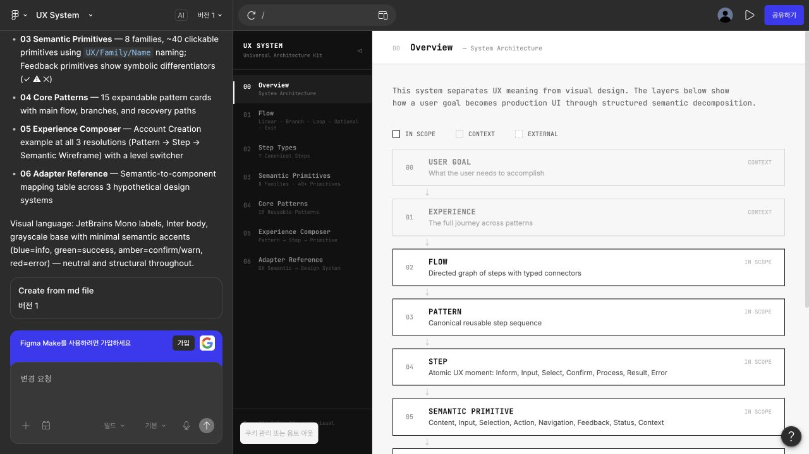
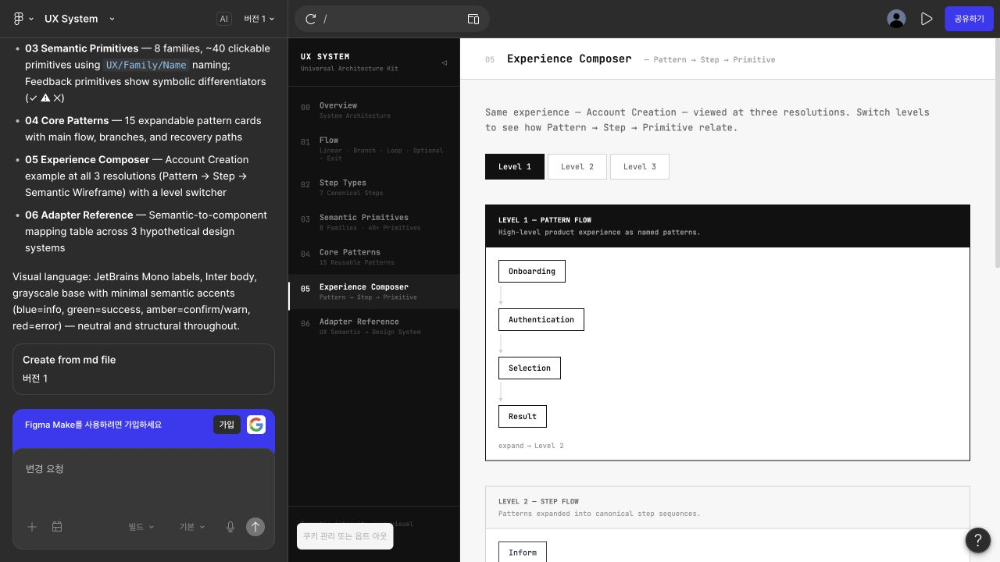
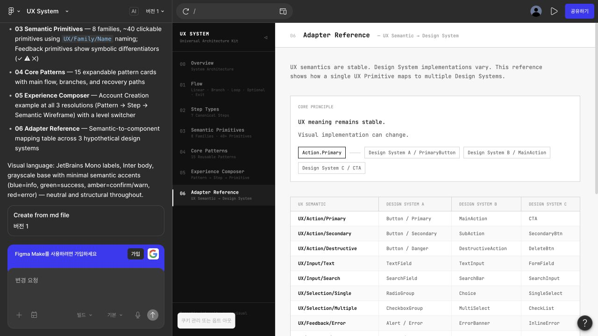
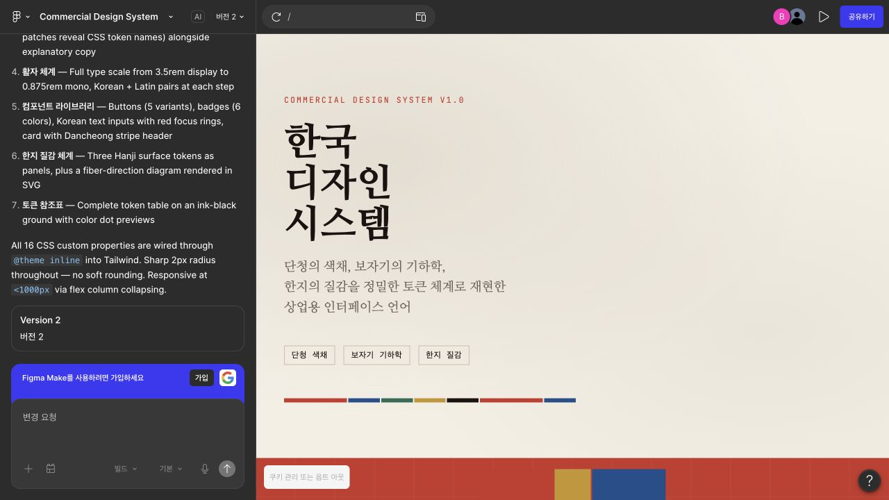

# Figma Make 시스템 샘플 — 초기 구조 검토

> 검토일: 2026-08-20  
> 범위: 사용자가 공유한 UX System과 Commercial Design System 공개 미리보기  
> 성격: 다음 실험을 정하기 위한 제한된 초기 검토. 10개 디자인 캐릭터 전체 평가는 아님.

## 1. 검토한 단계

| 단계 | 화면 | 상태 |
| --- | --- | --- |
| 1 | UX System — Overview | 좋음. UX 의미와 시각 구현의 분리가 명료함 |
| 2 | UX System — Experience Composer | 보완 필요. 분해 과정은 보이나 프리셋 선택 규칙과 맥락 입력이 부족함 |
| 3 | UX System — Adapter Reference | 매우 좋음. UX semantic과 디자인 시스템 component의 경계가 명확함 |
| 4 | Commercial Design System — Overview | 시각적 캐릭터는 강함. 범용 제품 적용성과 상태 커버리지는 추가 검증 필요 |

## 2. 화면 근거

### Step 1 — UX System Overview



- `User Goal → Experience → Flow → Pattern → Step → Semantic Primitive → Adapter → Design System → Implementation` 계층이 명확하다.
- UX 의미를 디자인 캐릭터보다 앞에 둔 구조는 현재 프로젝트 방향과 일치한다.
- 단, `User Goal`과 `Context`가 시스템 외부로 표현되므로 실제 생성 시 어떤 형식으로 입력하고 검증할지가 아직 계약화되지 않았다.

### Step 2 — Experience Composer



- Pattern, Step, Primitive 세 해상도를 오가는 설명은 교육과 생성 모두에 유용하다.
- 현재 Account Creation 예시는 한 가지 정상 흐름을 설명하는 데 강하지만, 위험도·빈도·되돌리기·권한·빈 상태·오류 복구가 프리셋 선택을 어떻게 바꾸는지는 드러나지 않는다.
- UX 프리셋을 5개의 완성된 화면 공식으로 정의하기보다, 목표별 우선순위와 제약을 가진 `Goal Profile`로 정의하는 편이 확장에 유리하다.

### Step 3 — Adapter Reference



- `UX/Action/Primary → 각 디자인 시스템의 실제 컴포넌트` 매핑은 이 시스템의 가장 강한 부분이다.
- 이 계층 덕분에 UX 의미를 유지하면서 디자인 캐릭터를 교체할 수 있다.
- 이후에는 단순 이름 매핑을 넘어 variant, state, density, responsive behavior, accessibility requirement까지 adapter contract에 포함해야 한다.

### Step 4 — Commercial Design System



- Swiss grid, 단청 색채, 보자기 기하, 한지 표면이라는 캐릭터가 즉시 인식된다.
- color, typography, geometry, surface, component, CSS token까지 한 언어로 연결한 점이 좋다.
- 공개 미리보기 기준 component 범위는 button, badge, input, card 중심이다. 실제 제품을 견디려면 navigation, forms, tables/lists, overlay, loading/empty/error, validation, focus, disabled, destructive, responsive와 content stress test가 필요하다.

## 3. 핵심 판단

현재 가설은 충분히 강하다. 다만 시스템을 다음 두 개의 선택지만으로 보면 부족하다.

```text
Product Brief
   ↓
Universal UX Kernel
   ↓
Goal Profile + Context Constraints
   ↓
Flow / Pattern / Step / Primitive
   ↓
Design Character Pack
   ↓
Adapter Contract
   ↓
Figma / HTML / App renderer
```

- `Universal UX Kernel`: 상태 가시성, 오류 예방, 접근성, 피드백 등 모든 제품에 공통인 규칙
- `Goal Profile`: 속도, 신뢰, 탐색, 학습, 모니터링처럼 목표에 따라 가중치가 달라지는 프리셋
- `Context Constraints`: 기기, 환경, 사용자 숙련도, 실패 비용, 빈도, 네트워크 등 제품별 사실
- `Design Character Pack`: 시각적·언어적 캐릭터를 만드는 토큰과 component recipe
- `Adapter Contract`: UX semantic을 해당 캐릭터의 component와 상태로 매핑

따라서 “UX는 하나가 답인가?”에 대한 현재 답은 다음과 같다.

> 공통 UX 원칙과 의미 체계는 하나의 kernel로 만들 수 있지만, 제품 목표와 실패 비용에 따른 우선순위까지 하나의 UX로 고정할 수는 없다.

## 4. 다음 검증 실험

새 디자인 시스템 제작은 잠시 멈추고, 기존 10개 중 성격이 가장 다른 3개만 선택한다.

하나의 reference product를 같은 콘텐츠와 기능으로 제작한다.

- 추천 주제: 워크숍·행사 탐색 및 예약 서비스
- 이유: 마케팅 소개, 탐색, 검색·필터, 상세, 선택, 폼, 확인, 결과, 계정 상태를 한 제품에서 검증 가능

### 실험 A — UX 불변성

같은 Goal Profile과 같은 flow에 디자인 캐릭터 3개를 적용한다.

- UX 의미와 정보 위계가 유지되는가?
- 캐릭터만 명확히 달라지는가?
- adapter로 해결되지 않아 flow까지 수작업으로 바뀌는 지점은 어디인가?

### 실험 B — UX 적응성

같은 디자인 캐릭터에 Goal Profile 3개를 적용한다.

- `Fast Completion`: 최소 단계와 빠른 완료
- `Trust & Safety`: 설명, 확인, 복구 강화
- `Discovery`: 탐색, 비교, 추천 강화

색과 장식이 아니라 정보 구조와 interaction이 실제로 달라지는지 본다.

### 실험 C — 교차 조합

3개 캐릭터 × 3개 Goal Profile 중 대표 조합 3개를 골라 끝까지 구현한다. 9개 전체를 고해상도로 만들 필요는 없다.

## 5. 평가 기준

각 조합을 1–5점으로 평가하고 근거와 수정 시간을 기록한다.

| 기준 | 질문 |
| --- | --- |
| Goal fit | 선택한 목표에 맞게 과업이 최적화됐는가? |
| UX integrity | flow, state, error recovery가 의미를 유지하는가? |
| Character fidelity | 다른 시스템과 혼동되지 않을 만큼 캐릭터가 유지되는가? |
| Adapter coverage | 수작업 예외 없이 semantic을 component로 매핑할 수 있는가? |
| Accessibility | 색 이외의 상태, contrast, focus, target, reflow가 확보되는가? |
| Portability | 같은 정의로 Figma와 HTML에서 같은 결과를 만들 수 있는가? |
| Repair cost | AI 생성 뒤 사람이 고쳐야 한 시간과 항목은 얼마나 되는가? |

## 6. 정본 형식 제안

Figma Make는 실험실과 renderer로 유지하되 정본으로 두지 않는다. 단일 HTML은 보기 좋지만 의미 구조와 validation이 약하므로 역시 정본보다는 viewer가 적합하다.

최소 구조는 다음 세 종류가 적절하다.

```text
system/
├── kernel.md                  # 사람용 원칙과 의미 정의
├── schema.json                # 기계 검증 계약
├── presets/
│   ├── goals/*.yaml           # UX Goal Profile
│   └── characters/*/pack.yaml # Design Character Pack
├── adapters/*.yaml            # semantic ↔ component/state 매핑
└── viewer.html                # 위 파일에서 생성되는 문서·샘플
```

파일 수를 더 줄이고 싶다면 초기에는 `kernel.md + catalog.yaml + viewer.html` 세 파일로 시작한다. 하나의 거대한 파일보다 조합·버전·검증·재사용이 쉽다.

## 7. 근거 한계

- 공개 Figma Make 미리보기에서 확인 가능한 구조와 화면만 검토했다.
- 10개 디자인 캐릭터 전체의 중복도·품질 분포는 확인하지 않았다.
- source code, 실제 Figma component/variable 구조, keyboard flow, screen reader, zoom/reflow는 검증하지 않았다.
- 접근성 적합성을 확정할 수 없으며 별도 구현·실기기 검사가 필요하다.

