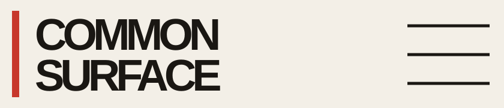

# COMMON SURFACE — 브랜드 아이덴티티 r1

> **상태:** `experiment-approved-synthetic` · Track 1 r1 정체성 정본  
> **Design Pack:** `Industrial Swiss System / pack:industrial-swiss@1.0.0`  
> **브랜드명 권리 상태:** 상표·도메인·시장 충돌 검토 전. 외부 사용·출원·제조 발주는 금지.

## 1. 브랜드명

### COMMON SURFACE / 커먼 서피스

모든 사람이 공유하는 피부의 표면과, 일상에서 반복되는 관리의 접점을 뜻한다. 성별·피부 유형·효능을 이름 안에 단정하지 않아 스킨케어와 머천다이즈, 오프라인 공간까지 확장할 수 있다.

- 표기 정본: `COMMON SURFACE`
- 한국어 읽기: `커먼 서피스`
- 제품·캠페인에서의 한글 설명: `피부를 위한 일상의 순서`
- 금지: `더마`, `클리닉`, `치료`, `남성용`, `여성용`, 근거 없는 기능성·친환경 수식어를 이름에 결합하는 방식

## 2. 로고 시스템

### 2.1 기본 워드마크

- 2행의 응축형 정보 워드마크와 우측의 세 기준선으로 구성한다.
- 좌측 적색 기준점은 시작 위치를 알리는 표식이며, 효능·경고·할인·긴급을 뜻하지 않는다.
- Pack의 강한 정보 위계와 하드 유틸리티를 브랜드 고유의 형태로 번역한 것이다.

### 2.2 축약 마크

축약 마크는 앱 아이콘, 패키지 측면, 의류 케어 라벨, 작은 안내 표식에서만 쓴다. 첫 노출, 파사드, OOH, 캠페인 헤드라인에는 기본 워드마크를 쓴다.

### 2.3 사용 규칙

| 항목 | 규칙 |
| --- | --- |
| 최소 크기 | 워드마크 28mm 인쇄 / 144px 화면 폭, 축약 마크 16mm / 32px 미만 사용 금지 |
| 보호 여백 | 워드마크는 적색 기준점 폭의 2배, 축약 마크는 마크 폭의 1/4 이상 |
| 허용 배경 | `CS-PAPER`, `CS-INK`, 또는 대비가 측정된 단색 배경 |
| 금지 | 기울임·윤곽선화·그림자·패턴 마스킹·색상 추가·비율 변경·문장 안의 로고 사용 |
| 공존 | 첫 노출에는 워드마크 하나만 둔다. 제품 코드와 제휴/법정 정보는 별도 레이블 군으로 분리한다. |

## 3. 언어·그래픽 결합

| 층위 | 역할 | 예시 |
| --- | --- | --- |
| 워드마크 | 브랜드 식별 | `COMMON / SURFACE` |
| 핵심 문장 | 매체당 하나의 메시지 | `피부를 위한 일상의 순서` |
| 제품명 | 코드와 짝을 이루는 작업명 | `CS-01 / RINSE / 젤 클렌저` |
| 사실 레이블 | 사실·권한·제한의 위치 | `FACTS PENDING`, `실험용 기록` |

로고가 모든 정보를 대신하지 않는다. 특히 패키지의 성분·용량·제조 정보, 매장의 재고·테스터 정보, 웹의 선택·저장 상태는 별도 정보 구조로 유지한다.

## 4. 매체 적용 우선순위

| 매체 | 기본 식별 | 보조 식별 |
| --- | --- | --- |
| 패키지 | 측면 또는 전면 상단 워드마크 | 작은 축약 마크, 제품 코드 |
| 오프라인 매장 | 파사드·윈도 워드마크 | 선반의 축약 마크·코드 |
| 티셔츠 | 한 면의 워드마크 또는 핵심 문장 | 넥/케어 라벨의 축약 마크 |
| OOH·광고 | 하단 워드마크 | 행동 문구와 목적지 |
| 웹 | 상단 워드마크 | 선택 상태의 축약 마크 사용 가능 |

## 5. r1 상업 사용 경계

이 아이덴티티는 디자인 시스템의 유지관리 실험을 위한 가상 자산이다. 실사용 전에는 최소한 상표·도메인·폰트 라이선스·로고 유사성·패키지 표시 요건·광고 문구·이미지 권리 검토를 통과해야 한다.
