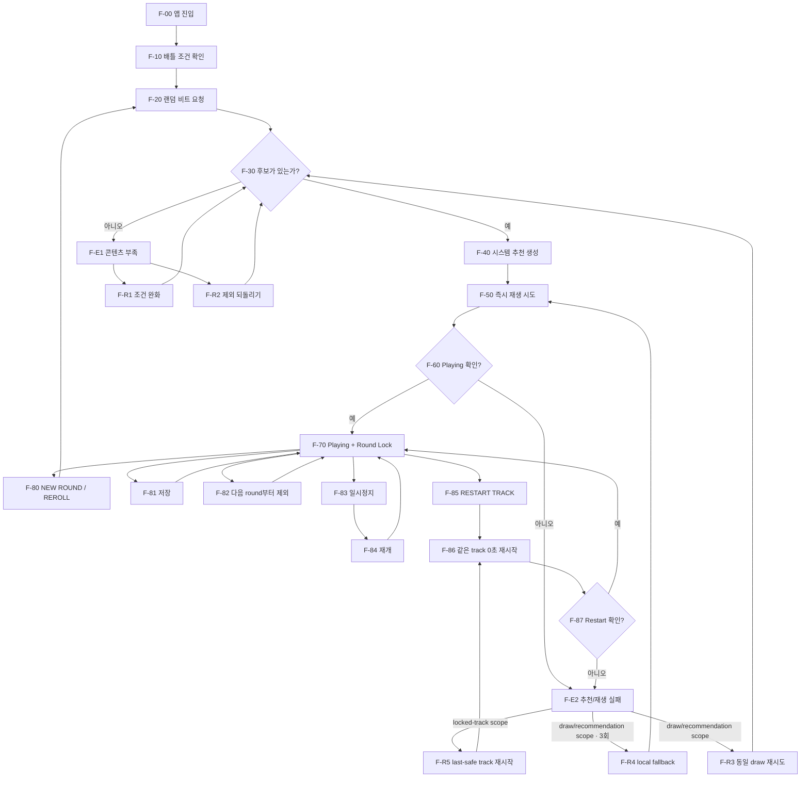

# User Flow — Battle Beat Randomizer

> Stable flow version: `flow.battle-beat-randomizer@1.1.0`
>
> Product Binding: `binding.battle-beat-randomizer@1.1.0` (`CR-01`)

## Pattern flow

## Stable steps and transitions

| Step ID | 입력 | 시스템 처리 | 보이는 결과 | 다음 전이 |
| --- | --- | --- | --- | --- |
| `F-00` | launch/resume | 세션 복구 가능성 확인 | synthetic prototype 표시 | `T-00→10` |
| `F-10` | battleType/energy 선택 | 유효 조건 갱신 | current condition | `T-10→20` |
| `F-20` | 첫 `ACT-RANDOMIZE` 또는 `ACT-NEW-ROUND-REROLL` | drawId·attemptId 생성, 중복 요청 잠금; targetRoundNumber를 1 또는 current+1로 기록하되 current round는 미변경 | `REQUESTING` + last-safe lock 유지 | `T-20→30` |
| `F-30` | 후보 pool 평가 | history/exclusion 적용 | 후보 또는 empty 이유 | `T-30→40`, `T-30→E1` |
| `F-40` | 추천 후보 | reason과 authority 생성 | `SYSTEM PICK` | `T-40→50` 자동 |
| `F-50` | autoplay attempt | synthetic state transition | `STARTING` | `T-50→60` |
| `F-60` | success/failure signal | attempt·draw·track 일치 검증 | Playing 또는 error | `T-60→70`, `T-60→E2` |
| `F-70` | confirmed state | 첫 성공은 Round 01, 이후 new-round 성공은 +1; track을 atomic lock | `PLAYING` + `ROUND NN · LOCKED` + track ID | `F-80`–`F-85` |
| `F-80` | `ACT-NEW-ROUND-REROLL` | 다음 round용 새 draw 요청; 현재 lock은 last safe로 유지 | pending next round + current lock | `T-80→20` |
| `F-81` | save | savedIds 갱신 | 현재 Playing/round 유지 | `T-81→70` |
| `F-82` | `ACT-EXCLUDE-NEXT-ROUND` | pendingExcludedIds에 현재 track과 적용 round 기록 | 현재 lock 유지 + `NEXT ROUND EXCLUDE` | `T-82→70` |
| `F-83` / `F-84` | pause / resume | 같은 round/track·elapsed 보존 | PAUSED / PLAYING LOCKED | `T-83→84→70` |
| `F-85` | `ACT-RESTART-TRACK` | draw/recommendation 없이 같은 lockedTrackId로 새 attemptId 생성 | `RESTARTING · SAME TRACK` | `T-85→86` |
| `F-86` / `F-87` | synthetic restart attempt/result | elapsed 0; roundId·trackId 불변 검증 | recovered Playing 또는 error | `T-87→70`, `T-87→E2` |

`F-40 → F-50`은 계속 자동이다. recommendation 뒤 별도 Start step을 삽입하지 않는다.

## Exception and recovery

| ID | 원인 | 보존 | 복구 | 안전 기본값 |
| --- | --- | --- | --- | --- |
| `F-E1` | 조건+적용 제외 후 후보 0 | battleType, energy, saved, applied/pending exclusion, lastSafeRound | 조건 완화 또는 적용 제외 취소 | 임의 트랙을 성공처럼 표시하지 않음; current lock 유지 |
| `F-E2` | 추천, synthetic playback 또는 restart 실패 | lastSafeRound, lockedTrackId, 현재 조건, 저장·제외 | 실패 scope가 draw/recommendation이면 retry·fallback, locked-track이면 same-track restart만 노출 | 새 Playing 전에는 round/track을 변경하지 않음 |
| `F-R1` | energy 조건 완화 | battleType, authorized drawId | 같은 draw에서 넓은 pool 재평가 | 변경된 조건을 명시; 새 draw 없음 |
| `F-R2` | 최근 제외 1건 취소 | 나머지 exclusion, authorized drawId | 같은 draw에서 pool 재평가 | 무엇이 복구됐는지 표시; 새 draw 없음 |
| `F-R3` | 동일 draw 재시도 | draw와 lastSafeRound context | 새 idempotent attempt로 `F-30` 재개; 새 draw 아님 | 중복 Playing/round 증가 방지 |
| `F-R4` | 최초/new-round draw에서 3회 연속 실패 | current condition, authorized drawId, lastSafeRound | 같은 draw 안의 local synthetic fallback | `FALLBACK` 표시; 성공 전 round/lock 불변; restart 실패에는 금지 |
| `F-R5` | locked round의 cue/재생/restart 실패 | roundId, lockedTrackId, saved/exclusion | 같은 track 0초 restart | drawId·roundNumber·trackId 불변 |

## Synthetic event log contract

각 실제 이벤트는 고유 `eventId`와 증가하는 `sequence`를 갖고 아래 stable type 중 하나를 사용한다. 이 로그는 prototype 상태 증거이며 실제 오디오·공인 배틀 기록이 아니다.

| Event type ID | 기록 시점 | 필수 참조 |
| --- | --- | --- |
| `EV-DRAW-REQUESTED` | 첫 요청 또는 `NEW ROUND / REROLL` | drawId, targetRoundNumber, conditions |
| `EV-ROUND-LOCKED` | synthetic Playing 확인 후 atomic lock | roundId, roundNumber, trackId, drawId |
| `EV-TRACK-RESTARTED` | same-track restart 성공 | roundId, trackId, attemptId, elapsed=0 |
| `EV-EXCLUDE-DEFERRED` | 현재 track을 다음 round 제외로 표시 | roundId, trackId, effectiveFromRound |
| `EV-FAILURE` | draw/playback/restart 실패 | scope, roundId, trackId, drawId/attemptId |
| `EV-RECOVERED` | retry/restart가 confirmed Playing으로 복구 | recoverySource, roundId, trackId |
| `EV-FALLBACK` | 최초/new-round의 기존 draw 안에서 local fallback 시작·성공 | drawId, outcome, targetRoundNumber, trackId |

## Retention policy

| 이벤트 | 정책 |
| --- | --- |
| Back | 단일 화면이므로 적용하지 않음. browser history는 앱 상태를 바꾸지 않음 |
| Cancel | pending request만 취소하고 조건·저장·적용/대기 제외·lastSafeRound를 보존 |
| Retry | 같은 draw/track 문맥과 마지막 안전 round를 유지하고 새 attemptId 사용. retry 자체는 drawId를 만들지 않음 |
| Resume | 조건·저장·제외·event log·locked round/track을 복구. Playing은 locked `PAUSED`로 복구 |
| Exit | sessionStorage 범위에서 draft·lock·log를 유지하며 새 commitment 완료를 암시하지 않음 |
