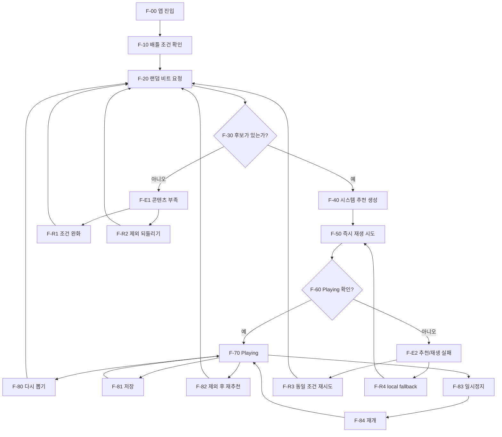

# User Flow — Battle Beat Randomizer

> Stable flow version: `flow.battle-beat-randomizer@1.0.0`

## Pattern flow

## Stable steps and transitions

| Step ID | 입력 | 시스템 처리 | 보이는 결과 | 다음 전이 |
| --- | --- | --- | --- | --- |
| `F-00` | launch/resume | 세션 복구 가능성 확인 | synthetic prototype 표시 | `T-00→10` |
| `F-10` | battleType/energy 선택 | 유효 조건 갱신 | current condition | `T-10→20` |
| `F-20` | `ACT-RANDOMIZE` | attemptId 생성, 중복 요청 잠금 | `REQUESTING` + 조건 유지 | `T-20→30` |
| `F-30` | 후보 pool 평가 | history/exclusion 적용 | 후보 또는 empty 이유 | `T-30→40`, `T-30→E1` |
| `F-40` | 추천 후보 | reason과 authority 생성 | `SYSTEM PICK` | `T-40→50` 자동 |
| `F-50` | autoplay attempt | synthetic state transition | `STARTING` | `T-50→60` |
| `F-60` | success/failure signal | attempt와 track 일치 검증 | Playing 또는 error | `T-60→70`, `T-60→E2` |
| `F-70` | confirmed state | elapsed/history 동기화 | `PLAYING` + track | fast actions |

## Exception and recovery

| ID | 원인 | 보존 | 복구 | 안전 기본값 |
| --- | --- | --- | --- | --- |
| `F-E1` | 조건+제외 후 후보 0 | battleType, energy, saved, exclusion | 조건 완화 또는 최근 제외 취소 | 임의 트랙을 성공처럼 표시하지 않음 |
| `F-E2` | 추천 또는 synthetic playback 실패 | 이전 confirmed Playing과 현재 조건 | retry 또는 fallback | 이전 Playing이 있으면 유지; 없으면 silence UI |
| `F-R1` | energy 조건 완화 | battleType | 넓은 pool로 재요청 | 변경된 조건을 명시 |
| `F-R2` | 최근 제외 1건 취소 | 나머지 exclusion | pool 재평가 | 무엇이 복구됐는지 표시 |
| `F-R3` | 동일 요청 재시도 | attempt context | 새 idempotent attempt | 중복 Playing event 방지 |
| `F-R4` | 3회 연속 실패 | current condition | local synthetic fallback | `FALLBACK` 표시, 정상 네트워크 추천으로 위장하지 않음 |

## Retention policy

| 이벤트 | 정책 |
| --- | --- |
| Back | 단일 화면이므로 적용하지 않음. browser history는 앱 상태를 바꾸지 않음 |
| Cancel | pending request만 취소하고 조건·저장·제외를 보존 |
| Retry | 조건과 마지막 안전 상태를 유지하고 새 attemptId 사용 |
| Resume | 같은 세션에서 조건·저장·제외·마지막 track metadata를 복구. Playing은 paused로 복구 |
| Exit | sessionStorage 범위에서 draft를 유지하며 commitment 완료를 암시하지 않음 |

