# Take 2 Flowchart

All stable IDs originate in the frozen binding and are retained in low-fi and high-fi.

```mermaid
flowchart TD
  E[ST-01 Entry / Ready] --> M{ST-02 Mode selected?}
  M -->|댄스 또는 랩| R[ST-03 System random recommendation]
  R --> A{User action}
  A -->|이 곡 재생| C[ST-04 User commitment]
  C --> P[ST-05 Playing: simulated visible result]
  A -->|다시 뽑기| R
  P -->|반복 유지| P
  P -->|다시 뽑기| R
  P -->|정지| R
  R -->|저장| S[LF-01 Local saved marker]
  R -->|제외| X[ST-06 Excluded candidate]
  X --> R
  R -->|콘텐츠 없음| N[ER-01 Empty / unavailable]
  R -->|네트워크 오류| F[ER-02 Recoverable network error]
  N -->|다시 시도| R
  F -->|다시 시도| R
  F -->|안전한 대기| E
```

## Transition table

| ID | From → To | Trigger | Authority | Visible consequence | Recovery / retention |
| --- | --- | --- | --- | --- | --- |
| T-01 | ST-01 → ST-03 | mode then `랜덤 선택` | system recommendation | candidate, mode, synthetic metadata | mode retained |
| T-02 | ST-03 → ST-04 → ST-05 | `이 곡 재생` | user commitment → simulated system result | `재생 중`, timer, stop/reroll actions | candidate retained |
| T-03 | ST-03/ST-05 → ST-03 | `다시 뽑기` | user request, system replacement | previous candidate is no longer current; Playing ends | mode retained |
| T-04 | ST-03 → LF-01 | `저장` | local preview | saved label; no account claim | candidate retained |
| T-05 | ST-03 → ST-06 → ST-03 | `제외` then replacement | user request | exclusion note then fresh candidate | mode retained |
| T-06 | ST-03 → ER-01 | synthetic content-empty trigger | system | empty reason and retry | mode retained |
| T-07 | ST-03 → ER-02 | synthetic network-error trigger | system | error reason; retry/safe wait | last safe candidate + mode retained |

## Invariants checked

1. `system recommendation`, `user commitment`, and `Playing` are separate states.
2. `다시 뽑기` never claims that an old candidate continues playing.
3. Each failure names a cause and exposes a local recovery.
4. Mode, candidate, status and primary CTA derive from the same preview state.
5. No real audio, music rights, network call, or persistence is represented as complete.
